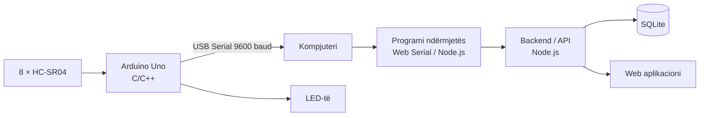

<div align="center">

# 🅿️ Sistem Inteligjent për Monitorimin dhe Menaxhimin e Parkimit në Qendra Tregtare

**Prototip IoT + Web për zbulimin e vendeve të lira, orientimin e shoferëve dhe gjetjen e veturës së parkuar.**


*Modulet STC dhe SEW • Viti akademik 2026–2027 • Mentore: Prof. Ass. Dr. Aferdita Ibrahimi*

</div>

<!-- Shto këtu një screenshot ose GIF të dashboard-it dhe një foto të modelit fizik -->
<!--  -->

---

## 📑 Përmbajtja

- [Përmbledhje](#-përmbledhje)
- [Funksionalitetet](#-funksionalitetet)
- [Arkitektura](#-arkitektura)
- [Pajisjet](#-pajisjet-hardware)
- [Skema e pinave](#-skema-e-pinave)
- [Logjika e zbulimit](#-logjika-e-zbulimit-të-zënies)
- [Struktura e repo-s](#-struktura-e-repo-s)
- [Instalimi dhe nisja](#-instalimi-dhe-nisja)
- [QR Code](#-qr-code--gjeje-veturën-time)
- [Testimi](#-testimi)
- [Plani i realizimit](#-plani-i-realizimit)
- [Ekipi](#-ekipi)
- [Kufizimet dhe zhvillimet e ardhshme](#-kufizimet-dhe-zhvillimet-e-ardhshme)
- [Licenca](#-licenca)

---

## 📖 Përmbledhje

Ky projekt realizon një **prototip për monitorimin e vendeve të parkimit** në një qendër tregtare. Një model fizik me **8 vende parkimi (P1–P8)** përdor sensorë ultrasonikë **HC-SR04**, të lexuar nga një **Arduino Uno**. Matjet dërgohen përmes **USB Serial** te kompjuteri dhe shfaqen në një **web aplikacion** në kohë reale: vendet e lira me **të gjelbër**, vendet e zëna me **të kuqe**.

Projekti kombinon **elektronikën, programimin e mikrokontrollerëve, komunikimin serial, databazat dhe zhvillimin web** në një sistem të vetëm të integruar.

## ✨ Funksionalitetet

**Hardware**
- 8 vende parkimi me nga një sensor HC-SR04 secili
- Sinjalizim me LED për çdo vend (gjelbër = i lirë, kuq = i zënë)
- Model fizik me vija ndarëse, hyrje, rrugë qarkullimi dhe miniatura veturash

**Web aplikacioni**
- 🗺️ Hartë vizuale e parkingut me gjendje live
- 🧭 Ndarje dhe filtrim sipas sektorëve
- 📊 Statistika: total, vende të lira, të zëna, probleme sensorësh
- 📱 QR Code për secilin vend dhe funksioni **“Gjeje veturën time”**
- 🔐 Kyçje e përdoruesve dhe ruajtja e kohës së qëndrimit
- 🕒 Rezervime vendesh me orën e daljes
- 🛠️ Panel administrativ për parametra, sektorë dhe gjendje
- ⚠️ Njoftim për humbje lidhjeje ose gabime sensorësh
- 💾 Databazë për vendet, matjet dhe historikun

## 🏗️ Arkitektura



| Shtresa | Përgjegjësia | Teknologjia |
|---|---|---|
| Sensorët | Matja e distancës për çdo vend | 8 × HC-SR04 |
| Mikrokontrolleri | Leximi dhe përgatitja e të dhënave | Arduino Uno, C/C++ |
| Komunikimi | Dërgimi i të dhënave te kompjuteri | USB Serial, 9600 baud |
| Ndërmjetësi | Leximi i portës seriale | Web Serial API / Node.js |
| Backend/API | Pranimi dhe shpërndarja e gjendjeve | Node.js |
| Databaza | Vendet, matjet, historiku, rezervimet | SQLite |
| Frontend | Harta, sektorët, statistikat, QR, administrimi | HTML / CSS / JavaScript |

> ℹ️ Arduino Uno **nuk ka Wi-Fi të integruar**, prandaj komunikimi me kompjuterin bëhet përmes USB-së.

## 🔌 Pajisjet (Hardware)

| Komponenti | Sasia | Shënime |
|---|---|---|
| Arduino Uno R3 | 1 | Mikrokontrolleri kryesor |
| Sensor HC-SR04 | 8 | Një për çdo vend parkimi |
| LED (gjelbër/kuq) | 8 | Sinjalizimi i gjendjes |
| Rezistorë për LED | 8 | Një në seri me secilin LED |
| Breadboard | 1 | Prototipim i lidhjeve |
| Jumper wires (FF / MF / MM) | ~40 | 20 FF + 20 MF |
| Kabllo USB | 1 | Komunikimi serial |
| Servo motor | 1 | *Opsional* – barriera hyrëse |
| LCD 16×2 | 1 | *Opsional* – numri i vendeve të lira |
| Bazë fizike + miniatura veturash | – | Foam board / MDF, deri në 8 vetura |

## 📍 Skema e pinave

> 🔌 **Konfigurimi aktual (6 vende + sensor hyrjeje + servo barriera)** dokumentohet
> i plotë — bashkë me analizën e ushqimit elektrik dhe protokollin serial JSON —
> te [`docs/HARDWARE.md`](docs/HARDWARE.md). Firmware:
> [`arduino/parkimi-7-sensore/`](arduino/parkimi-7-sensore/). Tabela më poshtë
> është plani origjinal me 8 vende dhe ruhet për referencë.

| Vendi | TRIG | ECHO |
|:---:|:---:|:---:|
| P1 | D2 | D3 |
| P2 | D4 | D5 |
| P3 | D6 | D7 |
| P4 | D8 | D9 |
| P5 | D10 | D11 |
| P6 | D12 | D13 |
| P7 | A0 | A1 |
| P8 | A2 | A3 |

- Të gjithë sensorët ndajnë **5V** dhe **GND**; secili ka **TRIG** dhe **ECHO** të veçantë.
- Sensorët lexohen **një nga një** për të shmangur ndërhyrjet ultrasonike.
- Nëse përdoret LCD me I²C, ai përdor zakonisht **A4/A5**.
- ⚠️ Skema duhet verifikuar me lidhjet e fundit para montimit të të 8 sensorëve.

## 📐 Logjika e zbulimit të zënies

Parametrat fillestarë për testim:

| Parametri | Vlera |
|---|---|
| Distanca maksimale | 10 cm |
| Pragu i zënies | 3 cm |

| Matja | Gjendja |
|---|---|
| ≤ 3 cm (e vlefshme) | 🔴 **E zënë** |
| > 3 cm dhe ≤ 10 cm | 🟢 **E lirë** |
| E pavlefshme / pa echo | 🟠 **Problem teknik** (nuk interpretohet si “e lirë”) |

> HC-SR04 ka kufi minimal praktik rreth **2 cm**, prandaj pragu duhet kalibruar fizikisht në model.

## 📂 Struktura e repo-s

> Përshtate sipas strukturës reale të projektit.

```text
.
├── arduino/            # Kodi C/C++ për Arduino Uno (sensorë + LED)
├── backend/            # API (Node.js) + databaza SQLite
├── frontend/           # Dashboard: hartë, sektorë, statistika, QR, admin
├── docs/               # Raporti, skemat, fotografitë, rezultatet e testeve
│   └── images/
├── .gitignore
├── LICENSE
└── README.md
```

## 🚀 Instalimi dhe nisja

### Kërkesat
- [Arduino IDE](https://www.arduino.cc/en/software) (ose PlatformIO)
- [Docker](https://www.docker.com/) + Docker Compose **ose** [Node.js](https://nodejs.org/) 20+
- Shfletues i bazuar në Chromium (Chrome / Edge) për **Web Serial API**

### 1. Klono repo-n
```bash
git clone git@github.com:Projekti-Sistemi-i-parkimit/Projketi-Sistemi-i-parkimit.git>
cd <Projketi-Sistemi-i-parkimit>
```

### 2. Ngarko kodin në Arduino
1. Hap `arduino/` në Arduino IDE.
2. Zgjidh **Board: Arduino Uno** dhe portën e duhur.
3. Ngarko (Upload) kodin dhe hap Serial Monitor në **9600 baud** për kontroll.

### 3a. Nisja me Docker (e rekomanduar)

I gjithë sistemi (backend + frontend + databaza) niset me një komandë të vetme:

```bash
cp .env.example .env      # vendos ADMIN_PASSWORD (e detyrueshme) etj.
docker compose up -d --build
docker compose logs backend   # çelësi API i urës shfaqet VETËM një herë këtu — ruaje!
```

- Aplikacioni: `http://localhost:3000` (porta ndryshohet me `PORT` në `.env`)
- Ndalja: `docker compose down` — **të dhënat RUHEN** në volumin `parking_data`
- ⚠️ **MOS** përdor `docker compose down -v` në operim normal — kjo **fshin databazën**!

**Arkitektura Docker:** një shërbim i vetëm — backend-i Node (imazh `node:22-slim`,
përdorues pa privilegje, healthcheck në `/api/health`, `restart: unless-stopped`)
shërben edhe frontend-in statik dhe mban databazën SQLite në volumin e qëndrueshëm
`parking_data` (`/data/parking.db`). Ura e Arduino-s punon në shfletuesin e operatorit
(Web Serial), prandaj kontejneri s'ka nevojë për qasje USB. Inicializimi i databazës
dhe seed-i (admini + çelësi API) ekzekutohen automatikisht në nisje dhe janë idempotentë.

| Variabla (.env) | Default | Përshkrimi |
|---|---|---|
| `PORT` | `3000` | Porta në host |
| `ADMIN_USERNAME` | `admin` | Admini fillestar |
| `ADMIN_PASSWORD` | — (e detyrueshme) | Fjalëkalimi i adminit fillestar |
| `BRIDGE_API_KEY` | (gjenerohet) | Çelësi API i urës; bosh = gjenerohet në nisjen e parë |
| `SESSION_TTL_HOURS` | `12` | Kohëzgjatja e sesionit të adminit |
| `PUBLIC_BASE_URL` | (bosh) | URL-ja publike në prodhim (p.sh. `https://autoparkoje.onrender.com`) — përdoret në kodet QR; bosh = adresa e shfletuesit |
| `OCC_THRESHOLD_CM` / `MAX_RANGE_CM` | `3` / `10` | Pragjet e klasifikimit (cm) |

### 3b. Nisja pa Docker (zhvillim lokal)
```bash
cp .env.example .env      # NË RRËNJË të repo-s — burimi i vetëm i konfigurimit
cd backend
npm install
npm run seed              # gjeneron çelësin API të urës (shfaqet vetëm një herë)
npm start
```
Kredencialet e adminit lexohen VETËM nga environment-i (`ADMIN_USERNAME` /
`ADMIN_PASSWORD` në `.env` e rrënjës lokalisht, ose Render → Environment në prodhim).

### 3c. Monitorimi lokal (opsional — Prometheus + Grafana)
```bash
docker compose --profile monitoring up -d
```
Prometheus: `http://localhost:9090` · Grafana: `http://localhost:3001` (vetëm
në 127.0.0.1, nuk deployohen në Render). Detajet: [`devops/README.md`](devops/README.md).

### 4. Hap dashboard-in
- Hap `http://localhost:3000` — frontend-i (dosja `frontend/`) shërbehet nga backend-i.
- Dokumentimi i API-së: `http://localhost:3000/api/docs`
- Hyrja e administratorit: butoni **“Hyrja Admin”** lart djathtas.
- Lidhja me Arduino: paneli admin → **“Lidhja Arduino”** → *Lidh USB* (Web Serial, kërkon Chrome/Edge/Brave) dhe vendos çelësin API të urës.
- Dy tema: **White Glass** (default) dhe **Black Parking** — ndërrohen nga navigimi dhe ruhen në shfletues.

> Për qasje nga pajisje të tjera (p.sh. telefona që skanojnë QR) aplikacioni duhet të jetë i hostuar online ose në të njëjtin rrjet lokal.

## 📱 QR Code / “Gjeje veturën time”

Çdo vend parkimi ka një **QR Code unik** që identifikon vendin (p.sh. `P3, Sektori A`).

1. Përdoruesi skanon QR-in e vendit ku parkon.
2. Sistemi ruan vendndodhjen dhe (opsionalisht) orën e daljes për rezervim.
3. Më vonë, te **“Gjeje veturën time”**, përdoruesi sheh vendin e ruajtur në hartë.

> QR Code **nuk detekton veturën automatikisht**; ai identifikon vendin që skanohet. Detektimi i zënies bëhet nga sensorët.

## 🧪 Testimi

Testet e automatizuara të backend-it (43 teste: autentikimi, sensorët, QR,
rezervimet, SSE, qëndrueshmëria e databazës, kufizimi i login-it):

```bash
cd backend && npm test
```

Testet manuale të sistemit të plotë:

| Testi | Rezultati i pritshëm |
|---|---|
| Vendi i lirë | Paraqitet i lirë, LED gjelbër |
| Vendi i zënë | Paraqitet i zënë, LED kuq |
| Pragu i distancës (rreth 3 cm) | Klasifikimi përputhet me konfigurimin |
| Pa echo | Shfaqet paralajmërim teknik |
| USB i shkëputur | Aplikacioni njofton humbjen e lidhjes |
| QR Code | Vendi identifikohet dhe ruhet |
| Ndërrimi i sektorit | Harta filtrohet sipas sektorit |
| Statistikat | Numrat përditësohen saktë |
| Databaza | Ndryshimi ruhet dhe lexohet saktë |

Rezultatet dhe fotografitë e testeve ruhen në [`docs/`](docs/).

## 🗓️ Plani i realizimit

- [ ] 1. Planifikimi (role, pajisje, skema e pinave, dizajni)
- [ ] 2. Testimi i sensorëve (2 ekzistues, pastaj 8)
- [ ] 3. Modeli fizik (bazë, vija, vende, sensorë, LED)
- [ ] 4. Arduino dhe USB (kodi C/C++, format serial i qëndrueshëm)
- [ ] 5. Frontend-i (hartë, sektorë, statistika, QR)
- [ ] 6. Backend dhe databaza
- [ ] 7. Testimi i përgjithshëm
- [ ] 8. Raporti dhe prezantimi

## 👥 Ekipi

| Anëtari | Roli | Përgjegjësitë kryesore |
|---|---|---|
| **Erblin Baliqi** | Koordinator, Arduino C/C++, integrim fizik | Afatet, komunikimi me mentoren, kodi Arduino, lidhjet fizike |
| **Isra Miftari** | Frontend/UX dhe QR Code | Harta P1–P8, sektorët, ndërfaqja responsive, QR, “Gjeje veturën time” |
| **Erdi Latifi** | Databaza | Modelimi i të dhënave, tabelat, saktësia e të dhënave |
| **Emir Daku** | Backend/API, DevOps | API, integrimi me Arduino, Git, mjedisi i zhvillimit, deploy |
| **Blend Arifi** | Rrjetet, pjesa fizike, testimi | Montimi, diagnostikimi i komunikimit, dokumentimi i rrjedhës së të dhënave |
| **Loresa Demiri** | Dokumentim dhe testim bazë | Raporti, lista e testeve, fotografitë, materialet e prezantimit |

**Mentore:** Prof. Ass. Dr. Aferdita Ibrahimi

## ⚠️ Kufizimet dhe zhvillimet e ardhshme

- Prototip me 8 vende; sensorët ultrasonikë janë të ndjeshëm ndaj këndit dhe sipërfaqes së objektit.
- Lidhja me kompjuterin është me kabllo (USB); një version i ardhshëm mund të përdorë ESP32/Wi-Fi.
- Zgjerim me historik të plotë dhe grafikë analitikë.
- Integrim i barrierës hyrëse (servo) dhe LCD për vendet e lira.

## 📄 Licenca

Projekti shpërndahet nën licencën **MIT**. Shiko skedarin [`LICENSE`](LICENSE) për detaje.

---

<div align="center">

Realizuar me  nga ekipi i moduleve STC dhe SEW • 2026–2027

</div>
